# Explainable Smart Traffic Detection System (ESTDS)
**MCA Major Project | AI-Powered Smart City Transportation Monitoring**

---

## 📌 Executive Summary

The **Explainable Smart Traffic Detection System (ESTDS)** is a full-stack, AI-driven intelligent transportation system designed for modern smart cities. It processes real-time and recorded CCTV/drone traffic video streams to detect vehicles, track unique instances, calculate spatial density and road occupancy, estimate traffic speed, and classify road congestion levels (**Low**, **Medium**, **High**).

Critically, unlike conventional "black-box" deep learning models, ESTDS integrates **Explainable Artificial Intelligence (XAI)** powered by **SHAP (SHapley Additive exPlanations)**. The system transparently explains *why* a particular traffic congestion state was predicted, isolating individual feature attributions (vehicle count, class distribution, occupancy percentage, average speed) in both intuitive graphical waterfall/bar charts and natural human-readable explanations.

---

## 🏗️ System Architecture

```mermaid
flowchart TD
    subgraph Client["Frontend Client (React + Vite + Tailwind CSS)"]
        UI_Dash["1. Traffic Dashboard\n• Aggregate vehicle metrics\n• Real-time congestion badge\n• Historical line & pie charts"]
        UI_Det["2. Vehicle Detection\n• Drag-and-drop video upload\n• Real-time progress bar\n• Video player with visual HUD"]
        UI_Ana["3. Traffic Analysis\n• Density meters & road occupancy\n• Speed telemetry\n• Temporal flow charts"]
        UI_XAI["4. Explainable AI (SHAP)\n• Local feature attribution waterfall\n• Global feature importance\n• Natural language reasoning\n• What-If traffic simulator"]
        UI_Rep["5. Reports & Audit\n• Session inspection\n• Detailed class distribution\n• One-click CSV export"]
        UI_Set["6. System Settings\n• YOLO confidence tuning\n• Hardware frame skip interval\n• Video duration limits"]
    end

    subgraph API_Gateway["Backend API (Flask REST + CORS)"]
        Routes["REST Blueprints\n(/api/dashboard, /api/detection, /api/analysis,\n/api/explain, /api/reports, /api/settings)"]
    end

    subgraph Vision_Core["Computer Vision & AI Inference Engine"]
        YOLO["Ultralytics YOLOv8n\n(Lightweight Real-time Detection)"]
        Tracker["Centroid-Based Multi-Object Tracker\n(Persistent ID Assignment & Trajectory Speed)"]
        Analytics["Spatial Traffic Analyzer\n(Density, Occupancy % & Congestion Rule-Engine)"]
        SHAP_Engine["Explainable AI Service\n(RandomForestClassifier + SHAP TreeExplainer)"]
    end

    subgraph Persistence["Storage Layer"]
        DB[(SQLite Database\nsessions, traffic_records, settings)]
        VideoStore[("Disk Storage\n/uploads, /processed, /demo")]
    end

    Client <-->|REST HTTP / JSON| API_Gateway
    API_Gateway --> Vision_Core
    Vision_Core --> Persistence
    API_Gateway <--> Persistence
```



---

## 🛠️ Technology Stack

| Layer | Technologies | Role |
|---|---|---|
| **Frontend** | React 19, Vite, Tailwind CSS 4, Recharts, Lucide Icons | Responsive smart-city dashboard, dark charcoal UI with orange accents |
| **Backend** | Python 3.14, Flask, Flask-CORS | Modular REST API and asynchronous background video processing |
| **Computer Vision** | OpenCV (cv2) | Frame extraction, video decoding/encoding, graphical bounding box & HUD rendering |
| **Object Detection** | Ultralytics YOLO (YOLOv8n) | Real-time vehicle detection (cars, motorcycles, buses, trucks) |
| **Vehicle Tracking** | Custom Centroid Multi-Object Tracker | Persistent tracking IDs, duplicate suppression, displacement calculation |
| **Explainable AI (XAI)** | SHAP (TreeExplainer) + Scikit-Learn | Local and global Shapley feature attribution, confidence scoring |
| **Database** | SQLite 3 | Relational storage for sessions, traffic telemetry records, and user settings |
| **Package Management** | pnpm (Node.js) & pip (Python) | Dependency resolution and environment reproducibility |

---

## 🚦 Core Modules

### 1. Dashboard
- Displays overall system metrics: Total Vehicles, Cars, Motorcycles, Buses, Trucks.
- Live traffic density percentage and color-coded congestion status badge (**Green** = Low, **Yellow** = Medium, **Red** = High).
- Historical vehicular volume line charts and fleet composition pie charts (powered by Recharts).
- Recent session audit table with quick-navigation links.

### 2. Vehicle Detection
- Supports uploading traffic footage in `MP4`, `AVI`, and `MOV` formats (up to 500 MB).
- Background worker processes video with frame-skip acceleration to optimize CPU/GPU performance on standard laptops.
- Annotates each frame with class-specific bounding boxes, confidence tags, and persistent vehicle IDs.
- Burns a real-time smart-city HUD onto the output video displaying current frame counts, density, and congestion.
- **Built-in Demo Mode**: Includes pre-generated sample CCTV video so evaluators can test real YOLO inference with a single click.

### 3. Traffic Analysis
- Computes vehicle density: $\text{Density} = \min\left(1.0, \frac{\text{Vehicle Count}}{\text{Baseline Capacity}}\right)$.
- Calculates physical road occupancy: $\text{Occupancy \%} = \frac{\sum \text{BBox Areas}}{\text{Frame Area}} \times 100$.
- Estimates vehicular velocity from multi-frame centroid displacement vectors calibrated to real-world highway scale.
- Multi-lane composition and vehicle category breakdowns.

### 4. Explainable AI (XAI)
- Eliminates "black box" decisions: Explains why traffic is categorized as Low, Medium, or High.
- **SHAP Waterfall/Bar Attribution**: Visualizes positive forces (increasing congestion) vs negative forces (pulling toward free-flowing traffic).
- **Natural Language Explanations**: Synthesizes human-readable justifications (e.g., *"Traffic congestion is HIGH because vehicle count (24) is very high, road occupancy (74.2%) indicates heavy congestion, and average speed (14.2 km/h) is slow"*).
- **What-If Traffic Simulator**: Interactive sliders allowing traffic controllers to simulate hypothetical traffic scenarios (e.g. increase truck volume, reduce speed) and observe real-time SHAP attributions and confidence shifts.

### 5. Reports & Audit
- Historical archive of every detection run with timestamps, processing durations, and vehicle distribution.
- One-click **Export to CSV** for individual session telemetry.
- Aggregate **Export All to CSV** for city-wide transportation reporting and data analysis.

### 6. Settings & Hardware Tuning
- Tunable YOLO detection confidence threshold ($0.10$ to $0.95$).
- Frame skip interval ($1$ to $15$) to balance inference accuracy against processing speed on standard laptops.
- Maximum allowable video duration guardrails ($10$s to $1800$s).
- Visual HUD toggle controls and dashboard refresh frequency.

---

## 📦 Project Structure

```
Accident detection/
├── backend/
│   ├── app.py                     # Flask application factory, CORS, static routes
│   ├── config.py                  # Environment configurations and limits
│   ├── requirements.txt           # Python dependencies (Flask, OpenCV, YOLO, SHAP, etc.)
│   ├── test_system.py             # Automated unit & integration test suite (5/5 passing)
│   ├── test_detection_pipeline.py # End-to-end YOLO + tracker + video write verification
│   ├── models/
│   │   ├── __init__.py
│   │   └── database.py            # SQLite schema, CRUD operations & connection pool
│   ├── routes/
│   │   ├── __init__.py
│   │   ├── dashboard.py           # /api/dashboard stats, history, recent endpoints
│   │   ├── detection.py           # /api/detection upload, demo, progress, results
│   │   ├── analysis.py            # /api/analysis detailed session telemetry
│   │   ├── explainability.py      # /api/explain SHAP attributions & simulator
│   │   ├── reports.py             # /api/reports session lists & CSV export
│   │   └── settings.py            # /api/settings configuration management
│   ├── services/
│   │   ├── __init__.py
│   │   ├── detector.py            # YOLOv8n video processing engine & HUD renderer
│   │   ├── tracker.py             # Centroid multi-object tracker with velocity tracking
│   │   ├── analytics.py           # Density, road occupancy, speed estimation
│   │   └── explainer.py           # RandomForest + SHAP TreeExplainer service
│   ├── utils/
│   │   ├── __init__.py
│   │   └── helpers.py             # Standardized JSON response formatting
│   ├── uploads/                   # Staged user video uploads
│   ├── processed/                 # Rendered video files with bounding boxes & HUD
│   └── demo/
│       ├── generate_sample_video.py # Synthetic sample CCTV video generator
│       ├── sample_traffic.mp4       # Pre-rendered 8s sample traffic video
│       └── seed_demo_data.py        # Database seed script for presentations
├── frontend/
│   ├── index.html                 # App HTML root with modern typography
│   ├── package.json               # Node.js dependencies (React 19, Vite, Recharts, Tailwind)
│   ├── vite.config.js             # Vite build & API reverse-proxy configuration
│   ├── src/
│   │   ├── main.jsx               # React DOM entry
│   │   ├── App.jsx                # Route definitions
│   │   ├── index.css              # Tailwind CSS theme & custom dark charcoal styling
│   │   ├── api/
│   │   │   └── client.js          # Axios API client with standardized interceptors
│   │   ├── components/
│   │   │   ├── Layout.jsx         # App shell with collapsible navigation
│   │   │   ├── Sidebar.jsx        # Navigation sidebar with Lucide iconography
│   │   │   ├── StatCard.jsx       # Reusable KPI metric card with orange accents
│   │   │   ├── VideoPlayer.jsx    # Custom HTML5 video player with styling
│   │   │   ├── ConfidenceBadge.jsx# Model confidence indicator
│   │   │   ├── LoadingSpinner.jsx # Smooth async state loader
│   │   │   └── ErrorMessage.jsx   # Friendly error notification component
│   │   ├── pages/
│   │   │   ├── Dashboard.jsx      # Executive overview & Recharts line/pie visualizations
│   │   │   ├── Detection.jsx      # Video upload, live progress & YOLO demo trigger
│   │   │   ├── Analysis.jsx       # Deep traffic telemetry & density meters
│   │   │   ├── Explainability.jsx # SHAP local/global attributions & What-If simulator
│   │   │   ├── Reports.jsx        # Session audit log & CSV downloaders
│   │   │   └── Settings.jsx       # AI confidence & frame skip sliders
│   │   └── utils/
│   │       └── helpers.js         # Formatting, colors, and file validators
├── run_backend.bat                # 1-click Windows launcher for Flask API
├── run_frontend.bat               # 1-click Windows launcher for Vite UI
├── run_all.bat                    # 1-click Windows launcher for the entire application
├── .gitignore                     # Git ignore rules for virtual environments, temp media, DB
└── README.md                      # Comprehensive project documentation
```

---

## 🚀 Installation & Execution Guide

### Prerequisites
1. **Python 3.10+** (Tested on Python 3.14.0 64-bit on Windows)
2. **Node.js 18+** & **pnpm** (or `npm`)
3. A Windows, Linux, or macOS workstation with minimum 4GB RAM

---

### Method 1: One-Click Execution (Windows)

Simply double-click `run_all.bat` in the project root:
```cmd
run_all.bat
```
This automatically starts:
- The Backend Flask server on `http://localhost:5000`
- The Frontend Vite development server on `http://localhost:5173`

---

### Method 2: Manual Terminal Execution

#### 1. Backend Setup
```bash
# Navigate to the backend directory
cd backend

# Install Python dependencies
python -m pip install -r requirements.txt

# (Optional) Run the automated test suite to verify the system
python test_system.py

# Start the Flask API server
python app.py
```
*The backend API will start on `http://localhost:5000`.*

#### 2. Frontend Setup
```bash
# Open a new terminal and navigate to the frontend directory
cd frontend

# Install dependencies (if not already installed)
pnpm install

# Start the Vite development server
pnpm run dev
```
*The frontend dashboard will be available at `http://localhost:5173`.*

---

## 🧪 Testing & Verification Report

The system includes an automated test harness (`backend/test_system.py` and `backend/test_detection_pipeline.py`) verifying all architectural layers:

| Test Case | Scope | Status | Result / Notes |
|---|---|---|---|
| `test_01_database_crud` | SQLite session creation, updates, record insertion, settings | **PASSED** | Verified persistent CRUD and settings key-value store |
| `test_02_centroid_tracker` | Multi-frame object matching, persistent IDs, disappearance | **PASSED** | Successfully tracked moving vehicles and maintained unique IDs |
| `test_03_traffic_analytics` | Density ratio, road occupancy %, speed estimation, classification | **PASSED** | Verified mathematical clamping and congestion thresholds |
| `test_04_shap_explainability` | Model training, global importance, local SHAP attribution values | **PASSED** | Verified RandomForest + TreeExplainer attribution extraction |
| `test_05_api_endpoints` | Health, dashboard stats, settings, explain POST, CSV export | **PASSED** | Verified 200 OK responses and `text/csv; charset=utf-8` export |
| `test_detection_pipeline` | Full end-to-end YOLOv8 inference on video + output video generation | **PASSED** | Verified 192-frame video processed with HUD and DB persistence |
| `pnpm run build` | Frontend Vite production compilation & Tailwind CSS bundle | **PASSED** | Built with 0 errors in 3.17s |

---

## 🔬 Explainable AI (XAI) Methodology

Traditional AI traffic monitors classify congestion using black-box neural networks, leaving municipal operators with no insight into why a road is marked as "Severe Congestion."

ESTDS implements cooperative game theory via **SHAP (SHapley Additive exPlanations)**:
$$\phi_i(v) = \sum_{S \subseteq N \setminus \{i\}} \frac{|S|!(|N| - |S| - 1)!}{|N|!} \left( v(S \cup \{i\}) - v(S) \right)$$

Where:
- $N$ is the set of all input features: $\text{vehicle\_count}$, $\text{car\_count}$, $\text{motorcycle\_count}$, $\text{bus\_count}$, $\text{truck\_count}$, $\text{avg\_speed}$, $\text{road\_occupancy}$, and $\text{density}$.
- $\phi_i$ is the marginal attribution of feature $i$ towards predicting a congestion class.

### Interpretation:
1. **Positive SHAP Value (Red)**: The feature pushes the probability toward heavier congestion (e.g. high vehicle volume, high occupancy).
2. **Negative SHAP Value (Green)**: The feature pulls the probability down toward free-flowing traffic (e.g. high vehicular speed).

---

## ⚠️ Known Limitations
1. **Camera Calibration**: Speed estimation utilizes an inter-frame pixel displacement heuristic. For high-precision velocity measurement, camera focal length, tilt angle, and ground plane homography must be calibrated for each physical camera location.
2. **Extreme Nighttime/Weather Footage**: Standard YOLOv8n is trained on the COCO dataset; severe rain, lens glare, or unlit rural roads may require fine-tuning on specialized low-light datasets (e.g., DAWN dataset).
3. **Hardware Scaling**: While YOLOv8n runs at 25–40 FPS on standard modern CPUs via frame skipping, processing dozens of 4K streams simultaneously in production requires NVIDIA GPU acceleration with CUDA/TensorRT.

---

## 🔮 Future Improvements
- **License Plate Recognition (ANPR)**: Integration of OCR (PaddleOCR/EasyOCR) for automated incident and violation logging.
- **Edge Deployment**: Conversion of YOLO models to ONNX Runtime and TensorRT for deployment on NVIDIA Jetson or Raspberry Pi edge devices.
- **V2X (Vehicle-to-Everything) Communication**: MQTT / WebSockets broker integration to broadcast emergency alerts directly to connected autonomous vehicles.
- **Dynamic Traffic Signal Control**: Reinforcement learning agent that automatically adjusts traffic light green-cycle durations based on real-time density calculations.

---

## 📄 License & Academic Declaration
This project is developed as part of the **MCA (Master of Computer Applications) Major Project Curriculum**.
Licensed under the **MIT License**.

